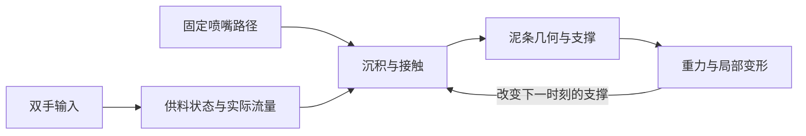

# 《失控陶坊》陶泥 3D 打印调研与模拟方案

调研日期：2026-10-23。当前应用基线提交：`029e03b`。

本文件是下一版的设计方案。本轮已提交现有应用，未修改线上模拟行为。研究依据为厂商技术资料、实践者的测试报告与两篇开放获取论文全文；没有进行实体机器测试。

## 1. 建议采用的方向

将模拟的核心改为：**喷嘴沿同一条预定路径移动，泥料经过有记忆的供料系统挤出，再因接触、支撑和重量形成不同结果。**

首个模拟对象明确为简化的气压直挤式单喷嘴设备，采用固定湿陶泥配方、固定速度、固定圆筒路径。该类型的连续挤出方式有实践依据，也便于用现有的“供料波动”和“供料中断”两个输入组织体验。[S2][S5]

这不是对 WASP 或 LUTUM 某一现售机型的复刻。它们的螺杆计量、回抽等结构会改变停料响应；后续确定合作设备后，应替换机器响应参数，必要时替换挤出模型。[S1][S3][S9]

下一版优先实现三件事：

1. **出料有过程**：波动导致粗细变化，欠供料经历变细、断开、恢复，参数归零后也有有限的响应时间。
2. **泥条有接触**：有支撑时压扁并贴合下层，缺支撑时可能跨过、下垂或断开。
3. **缺陷有后果**：缺口改变后续的落泥条件，过量沉积改变局部承重；恢复稳定供料不能抹去这些历史。



## 2. 真实设备有哪些区别

### 2.1 先区分运动、送料与计量

Jonathan Keep 将设备分为运动机构、打印头和泥料输送三个部分。Delta、笛卡尔和机械臂描述喷嘴如何移动，不能单凭这些名称推断如何出料。[S5，正文 pp. 5–7]

| 供料结构 | 调研依据 | 模拟上的含义 |
| --- | --- | --- |
| 气压直接挤出 | Keep 的早期自制打印头通过气压控制连续泥流；WASP 早期资料也记载了停流问题。[S2][S5] | 需要有限的启停响应，适合先模拟连续打印与供料扰动。响应时间仍须标定。 |
| 气压输送 + 喷头螺杆计量 | WASP 2040 Clay 的产品资料明确列出加压料筒和精密螺杆；LDM 资料说明能够回抽和控制启停。[S1][S9] | 不能把早期直挤设备的停流困难套用到现代螺杆打印头。 |
| 电机活塞直接推料 | 3D Potter 使用直接挤出，其 FAQ 说明活塞反向运动可用于回抽。[S3] | 可以处理不同稠度的泥料，启停模型也应区别于气压直挤。 |

“陶泥打印一定很难停料”“所有设备都要把泥调得很稀”都不适合作为通用规则。气泡、软管、泥料状态、喷嘴阻力和控制方式都会改变实际表现。

厂商的规格上限也不等于工作速度。例如 WASP 2040 Clay 当前列出 1.5、2、3 mm 喷嘴和 150 mm/s 最大打印速度；Keep 的对比试验使用 10–40 mm/s。模拟初值应参照具体工况，不能直接使用产品最大值。[S1][S6]

### 2.2 泥条不是圆管的简单叠加

Keep 的测试将喷嘴直径、层高、速度和泥料状态放在一起比较：其测试中，层高与喷嘴直径约 1:3 是一个起点；1:1 的组合在纹理、悬挑区域较早失效。实际壁宽也可能大于喷嘴直径，需要区分喷嘴孔径、沉积宽度和层高。[S5，正文 pp. 7–9][S6，pp. 1–3、10]

这个结论只适用于对应材料、形状与设备，不能当成所有陶泥的最优比例。它能支持的模拟规则是：

- 下方有支撑且间距适当时，泥条发生压扁，接触面增大。
- 间距过大或出料不足时，泥条不能充分贴合，局部可能失去连续性。
- 同样的出料量，在不同移动速度下，对应不同的单位路径沉积量。
- 悬空位置不能沿用有支撑位置的固定扁圆截面。

第一层还需要与打印板或泥底接触。Keep 也介绍了在预先擀好的泥板上打印器壁的做法。[S5，正文 pp. 9–10] 本项目可采用同一片预制泥底，让观众的操作集中在圆筒壁。

### 2.3 材料需要能挤出，也需要能站住

ACS Omega 的瓷泥研究区分了堵塞、可打印和塌落区域：改变分散剂比例和压力，可以让同一套工艺从难以挤出转为可打印，再转为无法保形。文中测量了剪切变稀、屈服相关性质和储能模量。[S7，§3.1–3.2]

Sensors 的研究同样强调流动与保形之间的平衡，其把手案例需要增加支撑来避免湿泥自重造成失稳。[S8，§3.1–3.2]

因此，数字泥料需要至少体现流动阻力、屈服阈值和沉积后的有限变形。触变恢复可以作为候选机制，但这些资料没有给出本项目所选泥料的可直接套用的恢复时间，不能凭文献名称填入一个“真实”常数。

不能简单认为“越硬越稳定”。Keep 的外扩器壁测试中，较硬泥条反而更早破坏下方器壁；他明确将结论限定在测试的形状与材料范围内。[S6，pp. 9–11] 首版保持一种固定配方，比增加一个未经标定的“硬度”滑块更合适。

### 2.4 缺料空隙、塌落与干燥裂纹是不同过程

- 供料不足会留下未沉积的区域，属于打印时的缺口。
- 新泥条跨越缺口，可能获得两侧支撑，也可能因自重下垂、脱开；不能只检测正下方一个点。
- 局部厚重区域会改变载荷，影响仍然可变形的支撑区。
- 干燥收缩、干燥开裂和烧成收缩发生于后续工序，不能作为供料中断的即时效果。[S5，正文 p. 10][S7，实验干燥与烧成流程]

首版的画面保持湿泥状态，只处理沉积和局部变形。缺料留下的开口可以称为缺口、断点或空隙；界面不把它们解释成干燥裂纹。

## 3. 现有实现需要改变什么

以下位置以基线 `029e03b` 为准：

| 当前行为 | 代码位置 | 下一版处理 |
| --- | --- | --- |
| 多组正弦波同时修改器壁半径和泥条粗细 | `src/simulation.ts:54` | 输入先作用于出料量，中心线与截面由沉积条件决定。 |
| 随机数每五个采样点决定是否留空 | `src/simulation.ts:65` | 改为有开始时间、持续时间和恢复过程的欠供料事件。 |
| 只检查前一圈同序号点，生成时直接扣掉固定高度 | `src/simulation.ts:67` | 查询邻近实际接触与可用支撑，再随模拟时间演化。 |
| 截面纵向比例始终是 `0.88` | `src/ClayScene.tsx:72` | 有支撑、悬空、受压采用不同截面，保持体积账目一致。 |
| 喷头绑定到最后一个沉积点 | `src/ClayScene.tsx:111` | 喷头只由预定工具路径驱动，泥条可相对喷嘴偏落。 |
| 按 55 秒进度生成点，不推进已有泥条状态 | `src/App.tsx:371` | 使用固定步长的模拟时钟，渲染读取结果。 |
| 收藏记录没有模拟版本 | `src/simulation.ts:22` | 新增版本与机器、材料配置，保留旧版重建入口。 |

现有保存历史、手势防抖、模型缓存和增量网格更新可以继续使用。旧版测试应保留；新材料模型使用独立的行为测试。

## 4. 观众体验与两项控制

### 4.1 一次体验

维持约 55 秒。所有人从同一片泥底、同一条圆筒工具路径和同一配方开始。开始前完成短暂预出料，避免将未充满喷嘴的启动状态与观众操作混为一谈。

打印中，喷嘴持续绕行并抬升；缺料时仍然走完路径。半透明轮廓显示原定器壁。泥条在落下、压扁和贴合时形成可见过程。

打印结束后停料、让喷头退开，给予局部变形一个有上限的收敛阶段，再定格供旋转和收藏。沉积与收尾共同纳入体验时长和过程记录；停止后继续流出的泥不能凭空消失。

### 4.2 两只手仍然只控制两项

| 输入 | 实际控制 | 观众看到的结果 |
| --- | --- | --- |
| 左手开合：供料波动 | 平均供料附近、连续且有时间相关性的扰动幅度 | 泥条逐渐变细、变宽，局部堆厚；满足条件时进一步出现褶皱。 |
| 右手开合：供料中断 | 短时欠供料事件的占空比 | 变细、断开、空走、逐渐恢复；可能在后续层形成连贯空隙。 |

新版默认两个参数均为零，产生稳定、可辨认的基准圆筒，由观众主动引入异常。随机种子只描述受控的工况扰动，不能额外给零扰动作品添加显著随机变形。

沿用双掌保持开始、双拳保持暂停，以及丢手后的暂停规则。观众页面继续保持极简：两个参数、必要状态和可重开的引导；压力、黏度、屈服值放在开发配置中。

“暂停”作为展览功能冻结模拟时间和出料状态，便于观众停下来观察。它不等同于只停止真实机器的运动轴；实体设备的暂停还需同步处理停料、回抽等动作。

### 4.3 最重要的对比情景

前半程波动大，后半程恢复稳定：底部留下厚薄变化和局部受压痕迹，上半部出现新的规则层纹，但不能把底部修圆。

中段发生一次较长欠供料，之后恢复：新泥条遇到下方空隙，两侧先接触，中间逐步下垂；再上一层根据已经改变的支撑条件沉积。

极端操作允许得到断裂、缺失或局部失败的作品。系统不能为了保持完整外形而暗中补料。

## 5. 计算模型

### 5.1 工具路径与时间

路径独立于陶器网格，输出位置、切线、移动速度和计划出料状态。圆筒采用连续螺旋抬升，避免每圈人为跳升造成不必要的接缝。

建议用于校准的初始工况是直径约 100 mm、64 圈、层高约 1 mm、喷嘴约 3 mm、路径速度约 25 mm/s。这是待试验的项目配置，不是某厂商推荐值。壁部路径约为 20.1 m，仅匀速走完就需要约 804 秒，即 13.4 分钟，不含预出料和收尾。

55 秒是加速播放。实际倍率根据完整模拟流程计算并记录，所有供料响应、材料龄期和局部变形共用同一模拟时钟。更改播放速度不能单独加速喷嘴，却保留另一套未缩放的泥料动力学。降低渲染帧率也不能改变最终结果。

### 5.2 挤出响应

为所选气压直挤设备使用可标定的简化响应：

```text
供压指令 = 基准工况 + 连续波动 - 短时欠供料扰动
Qeq = K * max(Pcommand - Pyield, 0)^m
dQ/dt = (Qeq - Q) / tau
本步离开喷嘴的体积 dV = integral(Q dt)
```

`Q` 是实际体积流量。`K`、`Pyield`、`m` 和 `tau` 都是机器与材料配置中的待标定参数。这里是经验响应曲线，不声称解出了完整的喷嘴流动方程；`tau` 也不是网络、摄像头或手势识别的延迟。

上升与下降可以使用不同响应时间，但只有比较记录支持时才引入额外参数。恢复时是否出现料团由供料状态与喷嘴存料决定，不为每次恢复强制添加鼓包。

欠供料由固定模拟时间上的带种子事件生成，有明确的持续时间。调高右手参数时提高欠供料占空比，事件具有最短开、关时间；不能按渲染帧独立抛随机数。输入为零时不再产生新事件，已经进入供料系统的扰动按其状态演化。

### 5.3 单位路径沉积量与截面

有支撑且连续沉积时，用体积守恒建立第一层联系：

```text
路径增量 ds = v * dt
沉积截面积 A ≈ dV / ds
截面积、局部喷嘴间距、接触约束 -> 泥条宽度与高度
```

有支撑区可以从椭圆或圆角截面开始；受压后降低高度、增加宽度，保持该段体积。供料不足时先减小截面，再根据连续性与接触条件断开。极低流量、停走和断开状态必须单独处理，不能直接除以趋近零的 `ds`。

超过局部容纳能力的泥料可以堆积或侧向挤出。褶皱还需要多余长度、接触条件等约束；不能同时把同一份泥量既用于增粗，又用于生成额外弯曲长度。喷嘴残留、已沉积和未落下的泥料分别记账。

### 5.4 支撑、接触与局部下垂

使用带体积和接触关系的泥条链段表示材料，保存出生时间、当前位置、初始体积、截面、相邻关系及局部材料状态。

查询喷嘴下方和周围实际泥条的接触范围，而不是默认上一圈同角度点一定是支撑。短跨度可受两端支撑；较长跨度随自重弯曲，过大时允许断开并落向可用支撑或平台。新层接触后，载荷传给下方接触区。

变形规则以重力、接触、近似屈服条件和阻尼为核心，保持有限、渐进的塑性变化。具体屈服阈值、黏接强度和恢复规律都需要校准；首版仅处理局部下垂、压扁和接触滑移，不预测整件器物的真实倒塌阈值。

需要严格区分两种“保留历史”：

- 出生时的泥量、输入事件、初始状态不会被后续调参改写。
- 已沉积湿泥的位置仍可能因新的接触和载荷发生变化，这种变化必须有可追踪的原因。

新泥料可以实际落入旧空隙，但不允许用重生成模型的方法抹掉空隙。材料也不能只因过了几秒就被当成已经干燥、永久固定。

### 5.5 视觉表达

喷嘴、出料短段、接触位置分别更新；泥条不与喷嘴刚性绑定。断流时保留喷嘴运动，并逐步耗尽可见出料短段。

已贴合区域呈现扁圆截面与接触压痕，悬空区保留较圆截面。切断处生成真实端面，避免只隐藏三角形后留下空管。网格法线随截面和中心线更新，侧光主要揭示实际几何。

保持灰白湿泥、简洁环境和必要的喷嘴及平台结构。粗糙度与微小表面细节不能代替泥条几何；首版不加入烧成光泽、干燥龟裂或与工况无关的整体噪声。

## 6. 实现与资源预算

### 6.1 浏览器内完成

延续静态页面、浏览器手势识别和 Three.js 渲染。材料模拟也在访问者设备上运行，公网服务器仍只提供资源转发，不新增推理或物理计算服务。

先保留约一万个路径采样点和现有 8 边截面的数量级，使用 TypedArray 与增量网格。新增模拟无需下载另一套 AI 模型；若引入数值依赖，应单独检查体积与适用性。

优先计算最近沉积区、悬空区，以及接触或承重变化所唤醒的支撑区。静止区可休眠，但不能永久忽略后续载荷。接触查询采用空间索引，避免每个新点遍历全部旧泥条。

先以独立模拟模块完成确定性验证和计时；必要时移入一个 Web Worker，通过双缓冲或增量消息交换状态，避免每帧克隆全部对象。通用刚体引擎并不能直接提供陶泥的塑性沉积行为，使用时也不能将刚体接触结果称为陶泥验证。

以下是待验收目标，尚未测得：

| 项目 | 目标 |
| --- | --- |
| 渲染 | 目标桌面 60 FPS；目标移动设备至少 30 FPS，同时开启手势检测。 |
| 新增模拟与状态传输 | 每个显示帧内的总工作量 p95 尽量控制在 4 ms 以内；与手势识别共同测量。 |
| 模拟新增常驻数据 | 优先控制在 20 MB 以内，单独统计 JS、Worker 与 GPU 数据。 |
| 新增常驻网络流量 | 无逐帧上传、无云端求解；静态代码更新后只影响首次资源加载。 |

性能降级先降低阴影、像素比和渲染更新频率。固定模拟步长、输入事件和材料常数不能随设备性能暗中改变。

### 6.2 与现有代码的边界

保留 `src/simulation.ts` 的旧版重建能力。新版按工具路径、挤出响应、沉积接触和局部变形划分职责，通过统一的固定步长入口推进。

`ClayScene.tsx` 接收独立喷头姿态，以及新增、变形、断开的泥条区间。`App.tsx` 管理输入和体验状态，不承担材料求解。`gestures.ts`、模型加载和缓存流程继续沿用现有实现。

### 6.3 收藏与复现

新版记录包括 `schemaVersion`、`simulationVersion`、机器与材料配置、路径配置、模拟步长、播放倍率、随机种子、输入事件、实际欠供料事件和结束时刻。参数事件以模拟 tick 为准，不能只依赖“已经生成了几个点”。

旧藏品继续使用旧版算法重建，不能升级页面后自动变成另一件作品。新版在同一算法和配置下应确定性复现；跨浏览器结果用数值容差验收，不承诺浮点数逐位一致。

优先保存事件与种子、缩略图，并按需重建。若加入几何快照或检查点，应使用 IndexedDB 并控制配额，不能把多件大网格直接塞入现有 localStorage。收藏时记录收尾阶段后的最终状态。

## 7. 实施顺序与验收

### 阶段 A：出料与路径

实现独立工具路径、有时间相关性的供料响应、有限时长的欠供料事件、体积守恒截面与接触压扁。先保留稳定支撑，不引入会掩盖出料问题的复杂塌落。

验收：零扰动得到连续圆筒；同一喷嘴路径上能看到粗细变化；停料后出现响应过程；恢复供料不改变此前记录。对一次阶跃输入，记录指令与实际流量曲线。

### 阶段 B：异常影响后续层

增加多点支撑查询、跨缺口下垂、局部压缩和有限的接触传播。更新网格与法线，补齐断口端面，完成新旧版本收藏兼容。

验收：同样的欠供料放在不同高度或不同支撑位置，结果不同；较长空隙相对短空隙产生不同的局部响应；新层依据实际支撑沉积；控制归零不会自动恢复旧形状。

### 阶段 C：选择性加强

在 A、B 的结果可解释且资源达标后，再考虑过量泥料褶皱、局部断裂后的有限堆积、喷嘴与堆高区域的刮碰。整体倒塌、干燥和烧成属于后续独立阶段。

### 固定验收情景

| 情景 | 预期 |
| --- | --- |
| 全程零扰动 | 形态稳定，无凭空生成的缺口。 |
| 前半程高波动，后半程归零 | 新层逐渐恢复规则，旧层不被重算成规则圆筒。 |
| 一次欠供料脉冲 | 指令、实际流量、泥条变细及断开在时间上有对应关系。 |
| 缺口上重新沉积 | 先形成接触，再随时间发生局部变形，而非一生成就瞬移到固定高度。 |
| 同输入、同配置、同种子，不同显示帧率 | 最终几何与累计出料量在约定容差内相同。 |
| 长时间暂停再继续 | 暂停不偷偷推进材料龄期或消耗泥量。 |
| 旧版收藏回放、新版导出导入 | 各自用对应算法复现，不互相覆盖。 |
| 移动设备开启摄像头，完整运行并收藏 | 记录帧耗时、内存及网络；无越界、NaN、无限拉伸和漂浮的失支撑段。 |

体积守恒单独检查：已离开喷嘴的泥量，应等于器壁、局部堆积、落料等状态的体积总和。收尾与断开不能通过删除材料来获得好看的形态。

## 8. 如何逐步校准为具体机器

实施阶段 A 就先做数字标定场景：直线泥条、稳定圆筒、一次阶跃、一次停料、已知宽度缺口。对照公开资料中的趋势；缺少匹配工况的录像或数据时，参数保持“展览标定”的身份。

有条件与技术人员合作时，固定一台机器、一种配方、一种喷嘴，完成少量相同试样：

1. 稳定供料直线：测宽度、高度与单位长度泥量。
2. 阶跃与停料：记录指令到出料变化的时间、残余泥量与恢复过程。
3. 小圆筒与局部空隙：记录跨距、下垂量和后续层的接触变化。
4. 同一工况重复打印：确认材料本身的离散程度。

录像需有尺标与时间信息；只看最终作品照片，无法区分供料失常、工具路径变化和后期修整。调节到相似外观也不等于物理预测已经验证。首版数字交付不以实体试验为前置条件。

## 9. 资料与证据范围

以下资料均于 2026-10-23 实际访问；两份 Keep PDF 和两篇论文读取了正文。论文使用 Europe PMC 的开放全文 XML 获取：[S7 全文](https://www.ebi.ac.uk/europepmc/webservices/rest/PMC11191105/fullTextXML)、[S8 全文](https://www.ebi.ac.uk/europepmc/webservices/rest/PMC10056007/fullTextXML)。资料中的特定配方、压力及速度仅属于其试验条件。

- **[S1] WASP：Delta WASP 2040 Clay 产品与技术规格。** [原文](https://www.3dwasp.com/en/clay-3d-printer-delta-wasp-2040-clay/)。依据：料筒加压与螺杆结构、喷嘴尺寸、最大速度。产品页的性能宣传不视为独立实验结论。
- **[S2] WASP：Evolution in clay 3D printing。** [原文](https://www.3dwasp.com/en/evolution-in-clay-3d-printing/)。历史文章，明确描述从难以停流的压力挤出升级为可回抽螺杆；不能代表现售设备仍有同样问题。
- **[S3] 3D Potter：3D Printing FAQ。** [原文](https://3dpotter.com/faq/)，重点为 Clay preparation、Retraction、Linear ram extruders 等部分。依据：直接推料、活塞回抽、泥料稠度与输送方式的关系。文中回抽的 E 轴数字受齿轮与丝杆换算影响，不能当成泥条实际移动一米。
- **[S4] VormVrij / LUTUM：Clay。** [原文](https://vormvrij.nl/brutum/faq/clay/)。依据：不同配方、喷嘴、速度与环境共同影响可打印性；螺杆、堵塞和水分迁移的关系。其材料建议不能直接推广为所有机器配方。
- **[S5] Jonathan Keep：A Guide to Clay 3D Printing，November 2020。** [介绍及下载页](https://www.keep-art.co.uk/guide-to-clay-3d-printing)；[PDF](https://img1.wsimg.com/blobby/go/7e9a9a3a-abb7-4e12-a8ce-e6dc98a55f2a/JKeep-Guide%20to%20Clay%203D%20Printing%20-%202020.pdf)。重点是正文 pp. 5–10：设备分工、送料、层高、喷嘴、第一层与泥底、支撑和干燥。页码采用正文印刷页码。
- **[S6] Jonathan Keep：Testing of the relationship between Nozzle Size, Layer Height, Print Speed and Material Consistency for Clay Extrusion 3D Printing。** [介绍及下载页](https://www.keep-art.co.uk/layer-speed-nozzle-clay)；[PDF](https://img1.wsimg.com/blobby/go/7e9a9a3a-abb7-4e12-a8ce-e6dc98a55f2a/Jonathan%20Keep%20Test%20Nozzle%20Layer%20Speed%20Clay%203D%20.pdf)。阅读了 11 页测试报告及配图。依据：8 cm 试样、喷嘴与层高比例、速度对比、硬泥的悬挑失稳。属于实践者控制变量测试，作者明确不将其作为普遍定律。
- **[S7] Wu et al.：Rheology and Printability of a Porcelain Clay Paste for DIW 3D Printing of Ceramics with Complex Geometric Structures，ACS Omega 9 (2024), 26450–26457。** [DOI](https://doi.org/10.1021/acsomega.4c02543)；[开放全文](https://pmc.ncbi.nlm.nih.gov/articles/PMC11191105/)。依据：特定龙泉瓷泥配方的流变性质，以及配方、压力对应的堵塞、可打印与塌落区域。不据此推定所有陶泥的常数或响应时间。
- **[S8] Marquez et al.：Direct Ink-Write Printing of Ceramic Clay with an Embedded Wireless Temperature and Relative Humidity Sensor，Sensors 23 (2023), 3352。** [DOI](https://doi.org/10.3390/s23063352)；[开放全文](https://pmc.ncbi.nlm.nih.gov/articles/PMC10056007/)。重点为 §2.2、§3.1–3.2：打印工况、流动与保形、把手支撑案例。文中不同试样使用不同喷嘴与层高，不合并为一个通用参数组。
- **[S9] WASP：WASP launches the new professional clay extruder。** [原文](https://www.3dwasp.com/en/wasp-launches-the-new-professional-clay-extruder/)。历史技术介绍说明气压与螺杆组合、回抽，以及气泡可能导致传统压力挤出断流。关于消泡及避免塌落的表述是厂商宣称，未用作模型的定量标定依据。
